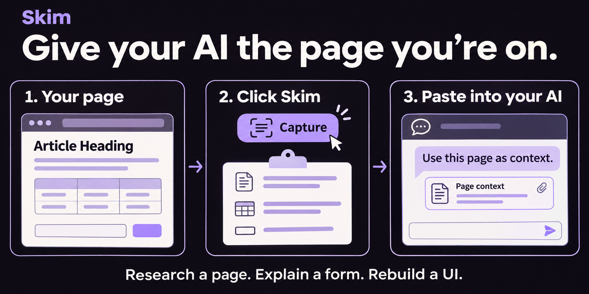

# Skim

**Give your AI the page you're on.**

Skim saves you from copying a page piece by piece. Click Skim, then paste the captured context into your AI chat or coding agent.

[Install Skim](docs/install.md) · [Use Skim](docs/usage.md) · [What Skim can read](docs/coverage.md)

## Ask better questions with the page attached

| You want to… | Give your agent the context and ask… |
| --- | --- |
| Understand an article or product page | "Compare the options and explain the tradeoffs." |
| Work through a form | "Explain these fields and the available choices." |
| Fix or rebuild a web interface | "Use this page code and screenshot as a reference." |
| Learn from a video | "Turn this transcript into notes with timestamps." |

Page text gives your agent details and links. A screenshot shows the layout. Page code supplies markup and styles. Available YouTube transcripts let you work with the video's words.

You choose what to capture and where to paste it. No account or AI API key is required.

## Keep control of what you share

Capture runs locally. Screenshots copy automatically, with no automatic file downloads or screenshot cache. AI summaries are optional and off by default.

Review the capture before sharing it. Redaction is best effort, and hidden or restricted content can be missing. Read the [coverage limits](docs/coverage.md) and [privacy details](docs/privacy.md).

## Release status

**1.2.1 is a release candidate.** Ten public-site cases passed. Final installed-toolbar acceptance is pending. Skim does not promise to capture every website.

Developing Skim? See [Contributing](CONTRIBUTING.md), [Testing](docs/testing.md), and the [changelog](docs/changelog.md).

Independent derivative of Peter Coles' [full-page capture extension](https://github.com/mrcoles/full-page-screen-capture-chrome-extension). [MIT license](LICENSE) · [Third-party notices](docs/third-party-notices.md).
