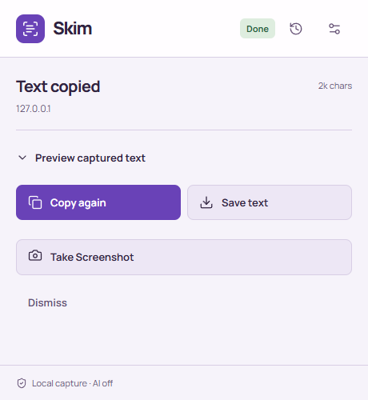

# Skim

Capture web context. Review what you share.

Skim is a local-first Chrome extension for copying page text, UI code and available YouTube transcripts, or reviewing full-page screenshots before export. No account, build step or AI provider is required.

[](https://github.com/kkamali04/skim/actions/workflows/test.yml)

<picture>
  <source media="(prefers-color-scheme: dark)" srcset="docs/images/popup-dark.png">
  
</picture>

## What it does

- **Page text:** structured text, links, form controls, permitted frame content and open shadow DOM, with capture coverage warnings.
- **Page code:** UI markup, accessible CSS, computed styles and asset references for development handoffs.
- **Reviewed screenshots:** stitch full pages or a main scroll pane, add opaque masks by dragging or keyboard coordinates, undo masks, then explicitly copy or save.
- **Complete captured-output export:** preview and save the current text without the history preview cap; save one PNG or a ZIP containing every reviewed screenshot part.
- **YouTube transcripts:** read the native transcript when YouTube makes it available, preserving timestamps and links. Live-site limitations are documented below.
- **Comfortable controls:** consistent local SVGs, purple light/dark themes, keyboard-accessible history and a fixed 400 × 600 frame with internal scrolling.

## Install

1. Download the ZIP from [Releases](https://github.com/kkamali04/skim/releases), then extract it to a permanent folder. Or clone this repository.
2. Open `chrome://extensions`, enable **Developer mode**, and choose **Load unpacked**.
3. Select the extracted folder containing `manifest.json`.
4. Pin Skim from Chrome's Extensions menu. Open a normal web page and click Skim, or use **Alt+Shift+P**.

Keep the popup open during capture. Opening it runs the configured default action. Text copies immediately; screenshots open a review first. Reload the extension from Chrome's extension page after updating its files. Skim is currently distributed as unpacked source, not a Chrome Web Store listing.

## A typical workflow

Click Skim on a page, inspect the text preview, then paste into your AI app, notes or document. **Save text** downloads the entire captured output; it does not remove extraction limits or recover inaccessible content. Change **Settings → Copy mode** to Code when you want markup/CSS.

Choose **Take Screenshot**, inspect each part, mask private areas, then **Copy reviewed part**, **Save this part · PNG**, or **Save all reviewed parts · ZIP**. The ZIP includes each part with its own masks. Automatic redaction is best effort and does not scan images with OCR.

History stays local. Large saved history entries are capped and carry a truncation warning; current text downloads are independent of that cap.

## Why is AI an on/off setting?

AI summarization is optional compression before text is copied. Leave it **off** to capture locally and paste into any AI app yourself. Turn it **on** only if you want Skim to send captured page text to the selected provider using your API key. Charges and provider retention policies may apply.

Configure an HTTPS OpenAI-compatible base URL, model and key in **Settings → AI summarization**. Presets are editable starting points, not a promise of model availability or account entitlement. The **Test provider** button sends a small test prompt and may be billable. Chrome's host permission is separate from the summarization toggle. Turning AI off stops automatic requests but does not revoke an already granted Chrome permission.

Changing provider/base URL clears the saved key and turns AI off. If summarization fails, Skim copies raw captured text and displays a failure warning. AI summaries can omit information; choose local capture when exact captured text matters. Screenshot, code and transcript captures do not use this summarization path. Read [Privacy](PRIVACY.md) before using it with sensitive pages.

## Limits and current status

- Chrome restricts internal pages, its Web Store and some documents. Cross-origin frames, closed shadow roots, canvas/video and inaccessible stylesheets may be unavailable.
- Infinite, virtualized, animated and changing layouts can yield incomplete captures. Large screenshots split into parts; nested layouts capture the main scroll pane and may omit floating overlays.
- Exported text reports coverage and truncation. Redaction recognizes common patterns, not every possible secret. Review before sharing.
- **YouTube depends on native transcript availability.** Skim supports the current and legacy transcript layouts. On November 2, 2026, the current layout was verified on a live public video (110 segments, 0:07–15:01). Some videos/profiles still return HTTP 400 or show site-access/ad-blocker restrictions; Skim reports failure instead of bypassing those restrictions or silently substituting page text.
- Automated browser tests use an isolated unpacked extension. Actual installed-toolbar gestures and provider permission prompts still require verification in the user's profile. See [Testing](TESTING.md) for exact evidence boundaries.

## Develop

Requires Node 22+ for development checks. The extension itself has no runtime package dependencies.

```sh
npm ci
npx playwright install chromium
npm test
npm run package
```

The package command creates `dist/skim-1.2.1.zip` from an explicit runtime-file list. Tests never need a real provider key. GitHub Actions runs the deterministic suite and packages the extension on pushes and pull requests. See [the workflow](.github/workflows/test.yml).

See [Contributing](CONTRIBUTING.md), [Testing](TESTING.md), [Privacy](PRIVACY.md), [Security](SECURITY.md) and [Changes](CHANGES.md).

## Credits and license

Independent derivative of Peter Coles' [full-page-screen-capture-chrome-extension](https://github.com/mrcoles/full-page-screen-capture-chrome-extension), under the preserved [MIT license](LICENSE). UI icons: Lucide/Feather. Typography: Manrope. Full licenses and pinned asset sources are in [Third-party notices](THIRD_PARTY_NOTICES.md).
